<p align="center">
  
</p>

<h1 align="center"><a href="https://twin-desk.vercel.app">TwinDesk</a></h1>

<p align="center">
  <b>Your Mac, your PC, your Linux box and your Android phone, working as one desk.</b><br>
  One mouse and keyboard for all of them. Their screens, apps, files, clipboard, cameras, calls and texts, shared.<br>
  Free and open source. No account, no cloud, no shared network needed.
</p>

<p align="center">
  <a href="#download"><b>⬇️ Download 2.5</b></a> ·
  <a href="https://twin-desk.vercel.app"><b>Website</b></a> ·
  <a href="#new-in-25"><b>What's new</b></a> ·
  <a href="#what-it-does"><b>What it does</b></a> ·
  <a href="#get-started"><b>Get started</b></a>
</p>

<p align="center">
  
  
  
  
  
  
  <a href="https://github.com/inukaasith/twindesk/releases"></a>
</p>

<p align="center">
  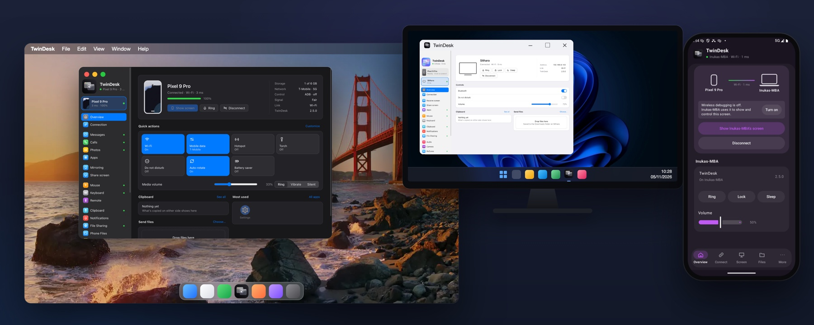
</p>


## What is TwinDesk?

You probably own more than one computer. A work laptop and a gaming PC. A MacBook and the Windows
machine you can't give up. A Linux box under the desk. And a phone that's never more than a metre
away. Each one is great on its own. Together they're a mess: two keyboards, files emailed to
yourself, a phone you keep picking up, the same tab opened three times.

**TwinDesk turns all of them into one desk.**

Push the mouse off the edge of your Mac's screen and it carries on onto the PC, keyboard and all.
Copy on one, paste on the other. Drag a file across the edge and drop it there. Open the PC's apps
in windows on your Mac. Turn a tablet or an old laptop into a second screen. Answer your phone's
calls and texts from the computer, use its camera in your video calls, and drive the computer from
the couch with it. And when you walk from one device to another, **ReZume** brings the tab, the
video or the document you were on with you.

It's one app on every platform, so a Mac and a PC pair exactly like two Macs, and a phone is a full
peer instead of a notification mirror.

<table>
<tr>
<td width="25%" valign="top">

**🔀 Any combination**<br>
Mac ↔ Windows, Mac ↔ Mac, PC ↔ PC, Linux ↔ anything, Android ↔ any computer. Or [all of them at once](#mesh).

</td>
<td width="25%" valign="top">

**📡 Anywhere**<br>
Same Wi-Fi, a USB cable, or no shared network at all: Bluetooth and a direct Wi-Fi link of their own.

</td>
<td width="25%" valign="top">

**🔒 Yours alone**<br>
No account, no cloud, no telemetry. Devices talk only to each other, end-to-end encrypted.

</td>
<td width="25%" valign="top">

**⚡ Built for speed**<br>
A native Rust input lane over UDP, a parallel file engine, hardware video. [How](#speed).

</td>
</tr>
</table>

<table>
<tr>
<td width="50%" align="center" valign="top">

**💻 Computer to computer**<br>
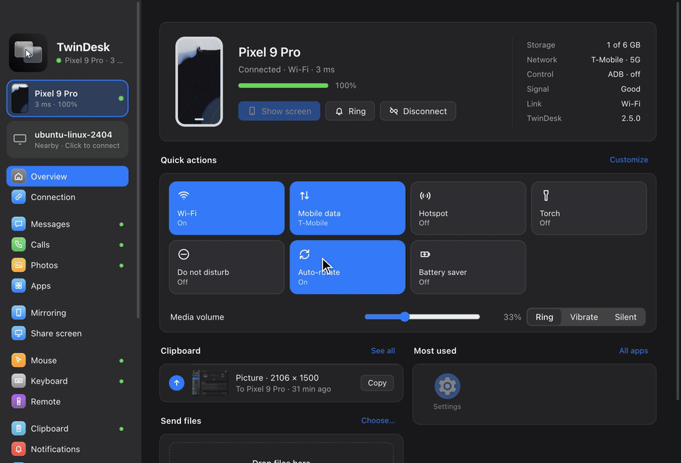

</td>
<td width="50%" align="center" valign="top">

**📱 Computer to phone**<br>
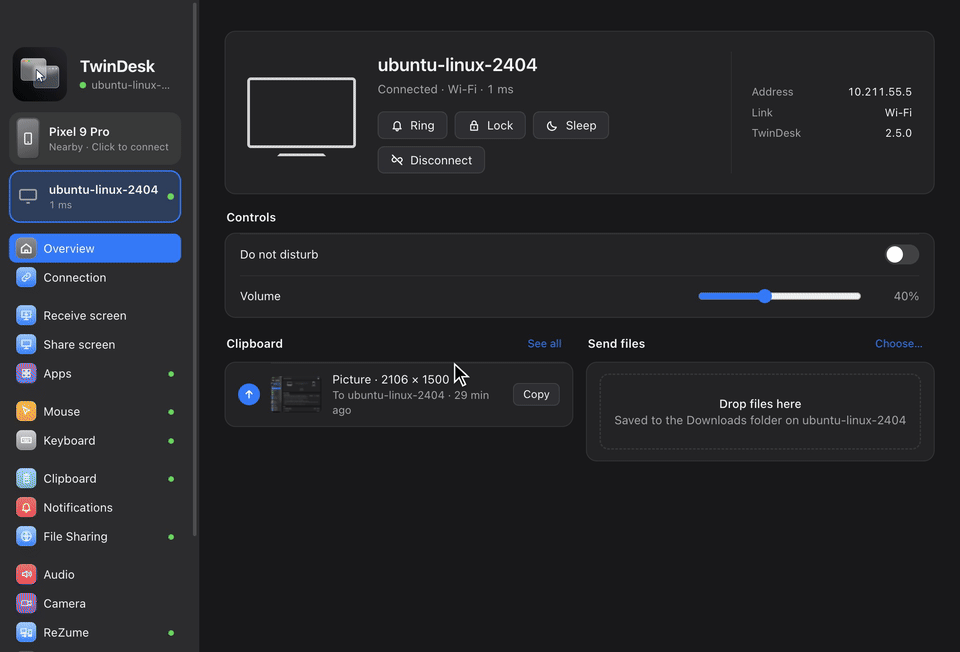

</td>
</tr>
</table>

<a name="download"></a>

## ⬇️ Download

<table>
<tr>
<td width="25%" align="center" valign="top">

**🍎 macOS**<br><sub>13 Ventura or later</sub>

<a href="https://github.com/InukaAsith/TwinDesk/releases/download/v2.5.3/TwinDesk-2.5.3-arm64.dmg"></a><br>
<a href="https://github.com/InukaAsith/TwinDesk/releases/download/v2.5.3/TwinDesk-2.5.3-x64_Intel.dmg"></a>

</td>
<td width="25%" align="center" valign="top">

**🪟 Windows**<br><sub>10 and 11</sub>

<a href="https://github.com/InukaAsith/TwinDesk/releases/download/v2.5.3/TwinDesk-Setup-2.5.3.exe"></a><br>
<a href="https://github.com/InukaAsith/TwinDesk/releases/download/v2.5.3/TwinDesk-Setup-2.5.3-arm64.exe"></a>

</td>
<td width="25%" align="center" valign="top">

**🐧 Linux**<br><sub>X11 and Wayland, x86_64</sub>

<a href="https://github.com/InukaAsith/TwinDesk/releases/download/v2.5.3/TwinDesk-2.5.3-amd64.deb"></a><br>
<a href="https://github.com/InukaAsith/TwinDesk/releases/download/v2.5.3/TwinDesk-2.5.3-x86_64.AppImage"></a><br>
<a href="https://github.com/InukaAsith/TwinDesk/releases/download/v2.5.3/twindesk-bin-2.5.3-1-x86_64.pkg.tar.zst"></a><br>
<sub>NixOS: <code>nix run github:InukaAsith/TwinDesk</code> (<a href="#nixos--nix-flakes">more</a>)</sub>

</td>
<td width="25%" align="center" valign="top">

**🤖 Android**<br><sub>10 or later, phones and tablets</sub>

<a href="https://github.com/InukaAsith/TwinDesk/releases/download/v2.5.3/TwinDesk-2.5.3.apk"></a><br>
<a href="https://github.com/InukaAsith/TwinDesk/releases/download/v2.5.3/TwinDesk-2.5.3-full.apk"></a><br>
<sub>The full app adds notifications, texts and Accessibility; the computer can install it for you over wireless debugging</sub>

</td>
</tr>
</table>

<p align="center">🍺 <b>Homebrew</b> on macOS: <code>brew install --cask inukaasith/twindesk/twindesk</code><br>
<sub>Update with <code>brew upgrade --cask twindesk</code>: TwinDesk opens again by itself if it was running, so a Mac you drive only through it gets its mouse back. The <a href="https://github.com/InukaAsith/homebrew-twindesk">tap</a> follows every release.</sub></p>

<a name="first-launch"></a>

<details>
<summary><b>⚠️ First launch: the apps aren't code-signed</b> <sub>how to allow them on macOS, Windows and Android</sub></summary>

TwinDesk is free and has no paid Apple Developer ID or Windows code-signing certificate, so
macOS and Windows don't know who made it and ask once before opening it. The source is all here.

**🍎 macOS**

The easiest way is **Homebrew**, which installs it ready to open:
`brew install --cask inukaasith/twindesk/twindesk`

From the .dmg instead:

1. Drag TwinDesk into Applications and open it. macOS says it can't verify TwinDesk: click **Done**
   (not Move to Bin).
2. Open **System Settings › Privacy & Security**, scroll down to Security and click **Open Anyway**
   next to "TwinDesk was blocked". Enter your password, then click **Open Anyway** again.

You do this once; updates open normally. If macOS says TwinDesk **is damaged and can't be
opened**, it isn't: run this in Terminal, then open it again:

```sh
xattr -dr com.apple.quarantine /Applications/TwinDesk.app
```

**🪟 Windows**

1. If the browser warns that the file isn't commonly downloaded, choose **Keep** (in Edge: **⋯ ›
   Keep › Show more › Keep anyway**).
2. When the installer shows **Windows protected your PC** (SmartScreen), click **More info**, then
   **Run anyway**.

On Windows 11 with **Smart App Control** on, unsigned apps are blocked with no Run anyway button.
The only way past it is turning it off (Windows Security › App & browser control › Smart App Control
settings), and on many Windows 11 versions it can't be turned back on without reinstalling Windows.

**🤖 Android**

1. Open the downloaded .apk. Android asks to allow your browser or Files app to **install unknown
   apps**: tap **Settings**, turn on **Allow from this source**, go back and tap **Install**.
2. If Play Protect warns about an unrecognised developer, tap **More details › Install anyway**.

The **full app** (notifications, texts and Accessibility) is easiest installed by the computer over
[wireless debugging](#wireless-debugging) (Phone page › Notifications from the phone): Android then
lets you turn those on. Installed by hand, Play Protect may block it, and Android 13 and later grey
out notification access and Accessibility as a **restricted setting**: open **Settings › Apps ›
TwinDesk**, tap **⋮ › Allow restricted settings**, then turn them on.

</details>

<p align="center"><sub>Every file and older version is on the <a href="https://github.com/InukaAsith/TwinDesk/releases">releases page</a>.</sub></p>


<p align="center">
  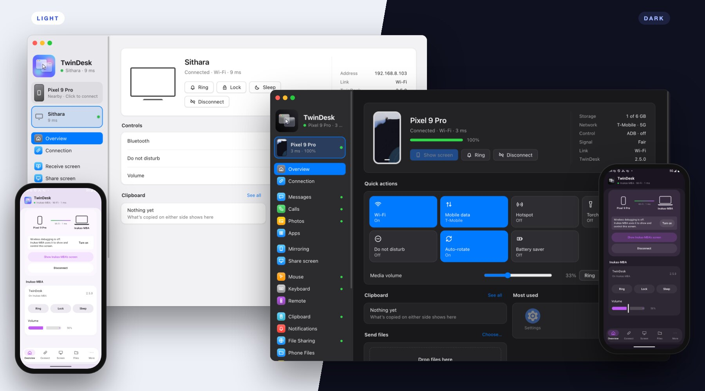
</p>

---

<a name="new-in-25"></a>

# ✨ New in 2.5

<p align="center">
  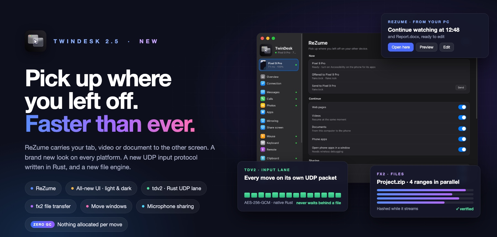
</p>

The biggest TwinDesk release yet. **ReZume** carries what you were doing to the other screen.
Every app has **an all-new look**, in light and dark. And underneath, the mouse and keyboard run on
**tdv2**, a new UDP protocol written in Rust, while files move on **fx2**, a new transfer engine.

| | What's new | |
|---|---|---|
| 🔁 | **ReZume.** The tab, the video at the same second, the document or the app you were on, continued on the other device | [More](#rezume) |
| 🎨 | **All-new look.** Redrawn on Windows, macOS, Linux and Android, in light, dark or system, with your accent color | [More](#new-look) |
| ⚡ | **tdv2.** Mouse moves on their own encrypted UDP lane, native Rust in the helper, nothing allocated per move | [More](#speed) |
| 📦 | **fx2.** Files in their own process, in parallel ranges, verified while they stream | [More](#speed) |
| 🪟 | **Move windows.** Hold Right Ctrl and drag a window past the edge: it moves to the other computer | [More](#move-windows) |
| 🎙 | **Microphone sharing.** One computer's microphone on the other, or the phone as a microphone | [More](#sound-and-microphone) |
| 🌍 | **Русский, Türkçe, 简体中文** on every desktop | |

<a name="rezume"></a>

## 🔁 ReZume: pick up right where you left off

<p align="center">
  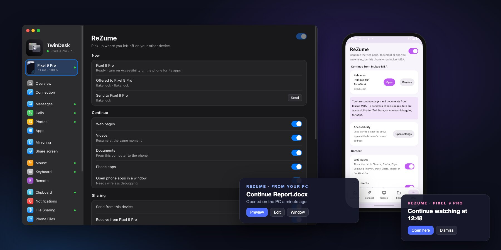
</p>

You were reading something on the PC. You sit down at the Mac. A button is already waiting in the
Dock: **Continue**. Click it and the same page is open, the video is at the same second, the
document is ready to edit.

- **Web pages,** read straight from the browser's address bar, opened in your default browser.
- **Videos at the same moment:** YouTube, Vimeo, Twitch, Dailymotion or a video file.
- **Documents three ways:** a **Preview** copy, **Edit** the original live (save on the Mac, it's
  saved on the PC), or the app's own **Window** streamed across.
- **App windows** for apps without a page or document, and **phone apps** in a window on the computer.
- **Phone ↔ computer:** the phone's tab or app on the computer, and *Open on computer* in the phone's share sheet.
- **Where it shows is up to you:** the taskbar or Dock, the tray or menu bar, a notification, the ReZume page.

<details>
<summary><b>How ReZume reads what you're doing, and what it never sends</b></summary>

| From | What | How it's read |
|---|---|---|
| Windows | Browser tab | The address bar through UI Automation, else the browser's own files |
| Windows | Document | Windows' Recent list matched to the window title; else the app's command line, PotPlayer's and VLC's lists, or Store apps (Photos, Media Player) by the app in their frame |
| Mac | Browser tab | Safari and Chromium browsers through Apple Events (asked once per browser); Firefox from its session |
| Mac | Document | The front window's document; for VLC, IINA and others, Spotlight's most recently used file of the name in the title |
| Linux | Browser tab | The address bar through AT-SPI (X11 and Wayland), else Firefox's session or Chromium's history |
| Linux | Document | `recently-used.xbel` and KDE's recent documents matched to the window title, or VLC's list |
| Phone | Tab or app | TwinDesk's Accessibility (full app), or wireless debugging when that's off |

- **Off until you turn it on,** one switch for the pair. Until then nothing is read and nothing is asked.
- **A document's path never leaves the device.** Only its name and size do, and the file goes only
  to the side that asked for it.
- **Edit** shares only that one file (and the lock and temporary files the app makes beside it),
  over WebDAV inside TLS with the session's own certificate and a secret path. It's unmounted when
  the session ends.
- **Preview** copies live in a cache folder that's emptied when TwinDesk quits.
- **Only `http` and `https` addresses are ever opened.**
- **Allowlists:** every app ReZume has met is listed with a switch, how often it was sent and when.
  New apps can start allowed or blocked.

The full design is in [docs/rezume.md](docs/rezume.md).

</details>

<a name="new-look"></a>

## 🎨 An all-new look, light and dark

<p align="center">
  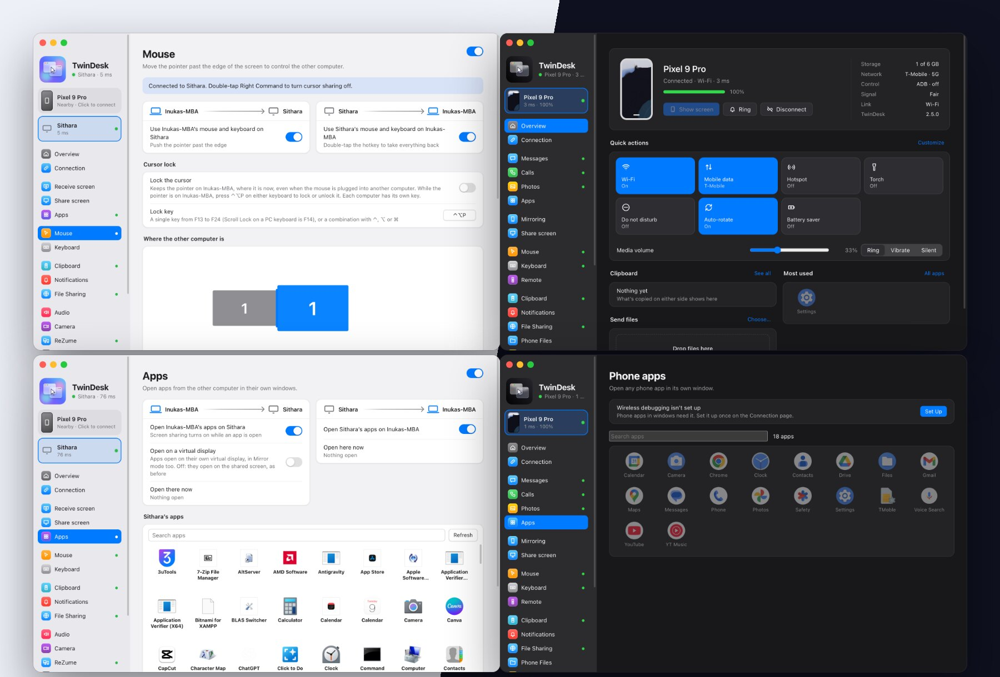
</p>

Every app was redrawn from scratch: Windows, macOS, Linux and Android.

- **Your devices in the sidebar,** with their latency and battery. One click to connect or switch.
- **A real Overview.** For a computer: Ring, Lock, Sleep, Bluetooth, Do not disturb and volume. For
  a phone: Wi-Fi, mobile data, hotspot, torch, auto-rotate, battery saver, ring mode, the clipboard,
  its most-used apps and a drop zone for files.
- **Every two-way feature as one card per direction,** named after your own devices.
- **Light, dark or system,** with an accent color of your own (General › Appearance).
- **The Android app in Google's Material style,** laid out for phones and tablets.

<a name="speed"></a>

## ⚡ A new engine: tdv2 and fx2

<p align="center">
  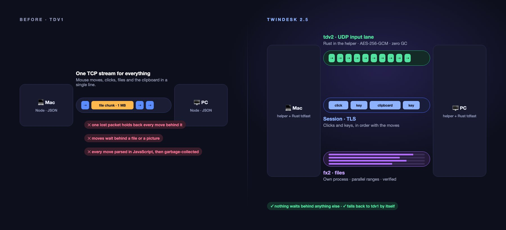
</p>

The fastest way to make the pointer feel like it's plugged straight into the other computer is to
make sure nothing ever stands in its way. In 2.5 nothing does.

- **tdv2:** every mouse move travels on its own encrypted UDP lane. A lost packet never holds back
  the next one, and a move never waits behind a file or a picture on the clipboard.
- **Native Rust, zero garbage.** The lane lives in `tdfast`, a small Rust core inside the native
  helper on every computer. Not a single object is allocated per move, so no garbage collector ever
  pauses your pointer.
- **fx2:** files move in a process of their own, in parallel ranges, hashed while they stream, so a
  big copy never slows anything else. 10,000 small files went from a PC to a Mac in under 48 seconds.
- **Always compatible.** Older TwinDesk, Bluetooth, or a firewall that blocks UDP? Everything falls
  back to the previous path by itself.

<details>
<summary><b>tdv2 in detail: the wire, the crypto and the guarantees</b></summary>

**Why.** Until 2.5 every mouse move rode the same TLS-over-TCP stream as everything else. On Wi-Fi,
one lost packet holds back every byte behind it until it's resent (head-of-line blocking), so the
pointer stuttered for 20–300 ms whenever the air got busy or a file was on its way. On top of that,
each move was turned into JSON in the helper, parsed by Node, and garbage-collected.

**The lane.** When both sides have 2.5, the session negotiates a UDP lane next to it (`il: {v: 1}`
in hello and welcome). Each move is one small authenticated packet:

```
'T''L' | ver | type | seq u64 | AES-256-GCM(body) | 16-byte tag
MOVE: route, move number, last event number, running total x, y
```

- **Exact under loss.** Each MOVE carries the running total, not a delta, so a lost packet costs
  nothing: the next one puts the pointer exactly where it belongs. The last move is sent again at
  +8 ms and +24 ms so the pointer always lands where you stopped.
- **Clicks never overtake moves.** Clicks and keys are numbered, fenced to the moves before them and
  sent on both the lane and the reliable session; the receiver applies them in order, exactly once.
- **Secure.** Per-session keys from HKDF-SHA256, AES-256-GCM, a 64-packet replay window as in
  WireGuard. Anything that doesn't authenticate is dropped.
- **Follows you.** The peer's address is the last authenticated packet's, so the lane follows a
  switch between Wi-Fi and cable.
- **Prioritised.** Voice-class DSCP marking (a qWAVE flow on Windows), and Windows' Wi-Fi
  low-latency mode while you drive.

**Native.** `native/tdfast` (Rust, C ABI) is linked into the Swift helper on the Mac, the C helper
on Linux and loaded by the C# helper on Windows. Moves go from the input hook to the socket and
from the socket into the OS's input without touching JavaScript. The helpers, Node's fallback lane,
Multi-device and the Android app allocate nothing per move, and the Windows helper runs with the
sustained-low-latency GC mode.

**Fallback.** No lane (an older app, Bluetooth, UDP blocked) means input stays on the session
exactly as before. General › Advanced › Input protocol lets you pick **UDP (tdv2)**, the default, or
**TCP (tdv1)**. The old and new protocols side by side: [docs/protocol.md](docs/protocol.md).

</details>

<details>
<summary><b>fx2 in detail: the file engine</b></summary>

- **Its own process.** A "TwinDesk Files" utility process runs its own HTTPS server, so reading,
  hashing and writing never block the window, the clipboard or input.
- **Parallel ranges.** A large file is fetched as several byte ranges at once.
- **Verified while streaming.** Every range is hashed on the way and the hashes travel with
  `file.end`, so a received file is checked without being read again.
- **Small files fast.** Up to 16 files in flight, asynchronous writes with backpressure on every
  receiver, and no O(n²) queue scans.
- **Hardened.** A file stops at the size it was offered with, a full disk fails cleanly, and a
  sender can't choose the name of a temporary file.
- **Negotiated** as `fx2` in hello and welcome. An early failure falls back to the previous HTTPS
  path, then to chunks on the session. Bluetooth, Wi-Fi Direct and older apps keep working.

</details>

---

<a name="what-it-does"></a>

# 💻 Computer to computer

<p align="center">
  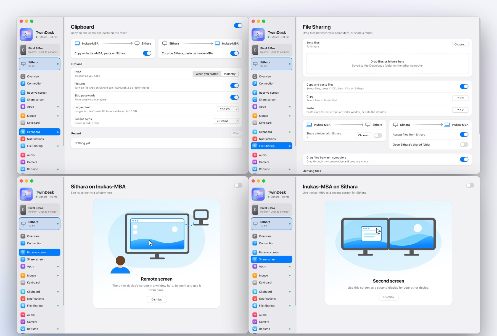
</p>

## 🖱 One mouse and keyboard

Push the pointer off the edge of your screen and **keep working on the other computer**, as if
they were one. Your keyboard follows the pointer, and so do Caps Lock, media keys, volume and
brightness. Trackpad gestures (Spaces swipes, pinch to zoom, show desktop) carry over. Each
computer's own trackpad takes its pointer back, shake the mouse to find the pointer, and a
double-tap of the hotkey brings everything home.

**Cursor lock** keeps the pointer on the computer it's on: press **Scroll Lock** (F14 on a Mac), or
use the Mouse page or the tray and menu bar.

<a name="move-windows"></a>

## 🪟 Move windows

Hold **Right Ctrl** (**Right Command** on a Mac), grab a window and drag it past the edge of the
screen. It moves to the other computer and keeps working there. Let go of it on the way back and it
returns to where you grabbed it.

## 🧩 The other computer's apps, in windows of their own

Open a **Windows app on your Mac** (or a Mac app on your PC) and it gets **a window of its own**,
with its own Dock icon or Start-menu pin. No full remote desktop, just the app you need, next to
your own.

<p align="center">
  
</p>

## 🖥 Extended display and remote screen

Extend your Mac onto a PC or another Mac with a **real virtual display**, or mirror it. Or bring
the other computer's screen into a window and control it from there. Low-latency **H.264 or H.265**,
hardware encoding with a fallback, *Fastest* and *Smooth* playback, and optional frame generation.

<p align="center">
  
</p>

## 📁 Files, shared folders and terminal

**Drag files across the screen edge** and drop them anywhere, or copy with <kbd>⌃⌥C</kbd> and
paste with <kbd>⌃⌥V</kbd> (<kbd>Ctrl+Alt+C/V</kbd> on Windows and Linux), into a folder or straight
into the app in front. Send from the macOS Share menu or Explorer's *Send to*, or **share a folder**
that shows up as a network drive on the other side. Big and small, files move on
[fx2](#speed). Need a shell? `ssh twindesk` opens one on the other computer, no passwords needed.

## 📋 Shared clipboard

Copy on one computer and paste on the other, instantly or when you switch over. **Pictures** go
too, up to 10 MB: take a screenshot with <kbd>Win+Shift+S</kbd> on the PC and paste it on the Mac.
Entries from password managers are skipped, and a Recent list keeps the last few things you copied.

## 📷 Camera sharing

Show the other computer's camera in a window, or send it to **a webcam every app can pick**:
**TwinDesk Camera** in Zoom, Teams, Meet or the browser. A computer shares its camera only when you
allow it, and a popup there says who is watching. The same works with a [phone's camera](#phone-camera).

<a name="sound-and-microphone"></a>

## 🔊 Sound, microphone, notifications and Wake-on-LAN

Hear one computer's sound on the other, and **use one computer's microphone on the other**, each way
on its own switch. See one computer's notifications on the other as native notifications. Wake a
sleeping computer with Wake-on-LAN.

<a name="mesh"></a>

## 🕸 TwinDesk Mesh: every device at once

<p align="center">
  
</p>

Your laptop, your desktop, the Linux box in the corner and your phone, **all connected at once**,
each talking straight to the others with no hub in between.

- **One mouse, every screen.** Line your devices up on the map once, and the pointer goes from the PC to the Mac to the Linux laptop to the phone.
- **One clipboard.** Copy on any of them, paste on any other. The newest copy wins.
- **One notification pool.** Your phone buzzes, and every computer shows it.
- **Pair once, join all.** A new device paired with one computer meets the rest by itself.

<details>
<summary><b>Mesh is in beta: what's in and what's still coming</b></summary>

Turn it on in the **Multi-device** page, and off again any time with everything as you left it.
Connecting just two devices? You won't need it. Still coming to Mesh: the Camera, ReZume, pictures
on the clipboard, and files dragged to more than one device at a time. The phone connects to one
computer at a time, and Linux joins over the same Wi-Fi only. Mesh uses the tdv2 lane in Node.
See [docs/mesh.md](docs/mesh.md).

</details>

---

# 📱 Phone and tablet

<p align="center">
  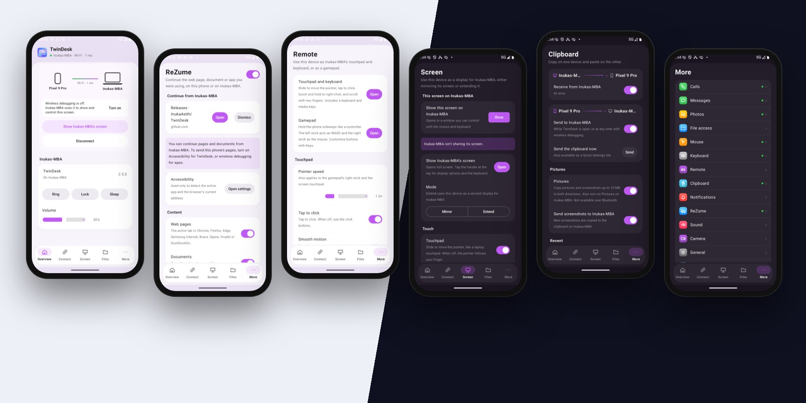
</p>

Most phone links stop at notifications and a file drop. In TwinDesk your Android phone or tablet is
a **full peer**: it pairs like a computer and gets the same features, plus its calls, texts, photos,
files, apps and camera.

<p align="center">
  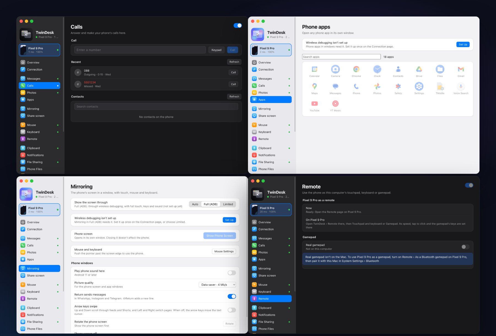
</p>

## 📞 Calls and messages

Answer, decline and make your phone's calls from the computer. When it rings, a small window shows
who's calling with **Answer** and **Decline**. With Bluetooth, the computer becomes **the phone's
headset**, so you talk and listen right there. Read and reply to your texts, WhatsApp, Instagram and
Telegram on **Messages**, pictures included.

## 📲 Phone apps in windows

Open **single Android apps in windows of their own**, side by side with your desktop apps. Pin them
to the Dock or the Start menu and use them like any other app, with your mouse and real keyboard.
Install .apk files on the phone straight from the computer.

<p align="center">
  
</p>

## 🖼 Photos and phone files

Browse the phone's **photos and videos**, open any of them big, save or remove one or many.
**Phone Files** browses the phone's whole storage: save, upload, rename, delete, or just drop files
on the page. **Shared folders work both ways.**

<a name="phone-camera"></a>

## 📷 Phone camera and microphone

The phone's **back or front camera** in a window on the computer or as the **TwinDesk Camera**
webcam in any video call, and the phone **as a microphone** for the computer.

## 🎮 Remote and gamepad

<p align="center">
  
</p>

- **Touchpad and keyboard** for the couch or a presentation, with the keys a phone keyboard lacks.
- **Gamepad,** laid out like an Xbox controller. Its buttons press the keys you choose, or turn on
  **Real gamepad** and the computer sees an actual controller (Windows and Linux).
- **A Bluetooth gamepad for any computer**, the Mac included, with no TwinDesk and no driver there.

## 🖥 Tablet as a second screen

Turn a tablet or phone into an **extra monitor**. **Extend** for more desktop space, or **Mirror**
to show what's on your screen. Use touch as the mouse, or switch on touchpad mode.

<p align="center">
  
</p>

## 📤 Files, clipboard, notifications, media, mouse and keyboard

- **Files.** *Send to computer* or *Copy to computer* from any Android app's share menu; from the
  computer, the Share menu, *Send to*, a drag across the screen edge or <kbd>⌃⌥C</kbd> / <kbd>Ctrl+Alt+C</kbd>.
- **Clipboard.** Text and pictures both ways, the phone's screenshots included.
- **Notifications.** The phone's on the computer as native notifications, per app, and the other way around.
- **Media.** What's playing on the phone, with play, pause, skip and seek on the computer.
- **Mouse and keyboard.** Push the pointer past the screen edge and it **carries on onto the phone**;
  type with your real keyboard in any Android app.

---

# 📡 Connections

<p align="center">
  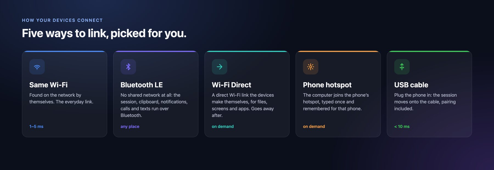
</p>

You never have to choose. TwinDesk uses the same network when there is one, moves a phone onto
the **USB cable** when you plug it in, and falls back to **Bluetooth** when the Wi-Fi goes: on a
train, or in a café whose guest Wi-Fi blocks devices. When a screen or a big file needs more than
Bluetooth, TwinDesk **brings up a direct Wi-Fi link** between the two devices for as long as it's
needed, then goes back.

<details>
<summary><b>What works over which link</b></summary>

| | Same Wi-Fi | USB cable | Bluetooth | + Wi-Fi Direct or hotspot |
|---|:-:|:-:|:-:|:-:|
| Session, clipboard text, notifications | ✅ | ✅ | ✅ | ✅ |
| Mouse and keyboard, remote | ✅ | ✅ | ✅ | ✅ |
| Calls and texts | ✅ | ✅ | ✅ | ✅ |
| Screens, apps, cameras, files, photos, clipboard pictures | ✅ | ✅ | moves to Wi-Fi Direct | ✅ |
| Terminal between computers (`ssh twindesk`) | ✅ | — | on Wi-Fi Direct | ✅ |

Who can turn up over Bluetooth is up to you: **Bluetooth with phones** (on) and **Bluetooth with
computers** (off until you want it), on the Connection page.

</details>

---

<a name="get-started"></a>

# 🚀 Get started

1. **Download** TwinDesk for each computer and your phone ([above](#download)).
2. **Open it on both.** They find each other on the same network, over Bluetooth, or over a USB cable for a phone.
3. **Pair once** by comparing a code or scanning a QR code (on a USB cable, just click Allow). From then on they connect by themselves.
4. **Turn on what you want.** Every feature starts off and isn't even loaded until you switch it on.

For the phone's screen, apps and camera in windows, TwinDesk walks you through turning on Android's
wireless debugging once ([details](#wireless-debugging)). Files, clipboard, calls and photos work
without it.

| Pair | What you get |
|---|---|
| Mac ↔ Windows PC, Mac ↔ Mac, PC ↔ PC | Every computer feature |
| Linux ↔ Mac, PC or Linux | Every computer feature ([a few differences](#linux)) |
| Android ↔ Mac, Windows or Linux | Every phone and tablet feature (Real gamepad on Windows and Linux) |
| All of them at once | [TwinDesk Mesh](#mesh) (beta) |

<a name="privacy"></a>

## Privacy

TwinDesk only talks to devices you've paired with, directly over your own network, Bluetooth, a
direct Wi-Fi link or a cable. There are no accounts, no telemetry and no cloud relay. Your calls,
texts, photos and camera go straight from the phone to your computer and nowhere else. Pairing
locks out an address that keeps guessing wrong. The only internet request is an update check
against GitHub's public releases, which you can turn off.

<br>

---

Everything below is for the curious and for people building TwinDesk themselves.

<a name="linux"></a>
<details>
<summary><h2>🐧 Linux</h2> <sub>X11 and Wayland, shared folders, Extend, virtual camera and gamepad</sub></summary>

On Linux, TwinDesk runs on both X11 and Wayland. On Wayland, the mouse and keyboard go through
evdev and uinput (the Setup screen grants access once), screens are captured through the desktop
portal, and the clipboard goes through wl-clipboard. A few things work a little differently:

- **Input access on Wayland.** Reading `/dev/input` means reading every key typed, so it goes to
  TwinDesk's helper alone: Setup's Fix installs a setgid `input` copy of the helper (the NixOS module a
  wrapper) and never adds your account to the `input` group. General › Input access › Remove undoes it.
  Details and the manual undo are in [docs/nixos.md](docs/nixos.md#1-wayland-mouse--keyboard-kvm).

- **Shared folder.** Sharing uses Samba. The first time, one password prompt installs it if it's
  missing and adds a network-only account. The other computer's folder is connected with GVFS
  and shows in the file manager's sidebar.
- **Copy and paste files.** <kbd>Ctrl+Alt+C</kbd> copies what's selected in the file manager in
  front (or files you already copied), and <kbd>Ctrl+Alt+V</kbd> pastes into the file manager
  window in front (else Downloads). Right-click › *Send to* works in Nautilus, Nemo, Caja,
  Dolphin and Thunar.
- **Dragging files across the edge.** Files dragged in from the other computer are dropped into
  the folder under the pointer, or the desktop. On Wayland, they go to the file manager window in
  front. Dragging files out of Linux needs an Xorg session.
- **Extend.** On GNOME (Wayland) it uses Mutter's own virtual monitor; pick "Virtual remote
  monitor" when the desktop asks which screen to share. On X11 it switches on a spare output of
  the graphics driver (not available on NVIDIA's driver). That needs a small helper, which the
  .deb installs; with the AppImage, Share screen › *TwinDesk virtual display* › Install puts it in
  once, with your password.
- **Apps and ReZume windows.** Opening this computer's apps on the other side needs an Xorg session.
- **Virtual camera and gamepad.** TwinDesk Camera is a v4l2loopback device, and Real gamepad a
  uinput controller ("TwinDesk Gamepad"); each asks for your password once, the first time it's
  turned on.
- **Bluetooth and Wi-Fi Direct.** Bluetooth LE goes through BlueZ, and direct Wi-Fi links through
  NetworkManager, hosted beside the computer's own Wi-Fi where the adapter allows (2.4 GHz groups
  for a phone).
- **The input lane.** If firewalld blocks inbound UDP, the tdv2 lane never comes up and input stays
  on the session, as in 2.4.
- **Android phone.** Everything in [Android](#android-in-detail) works on Linux too. The package
  carries adb; the Setup screen's firewall fix opens mDNS (5353/udp) so the phone's wireless
  debugging is found.

</details>

<a name="android-in-detail"></a>
<details>
<summary><h2>🤖 Android in detail</h2> <sub>the phone app page by page, and wireless debugging</sub></summary>

Install TwinDesk on the phone, open it next to TwinDesk on the computer and pair from Connect ›
Nearby, or scan the computer's QR code. The phone needs Android 10, and Android 11 for everything
that goes through wireless debugging.

### The phone app

Tabs at the bottom on a phone (Overview, Connect, Screen, Files, More), a sidebar on a tablet. Every
page names the computer it's connected to:

| Page | What it does |
|---|---|
| **Overview** | The computer you're connected to, its TwinDesk version, Ring, Lock, Sleep and its volume |
| **Connect** | Connect, Disconnect and Switch, nearby computers to pair with, QR pairing, Bluetooth, and the wireless debugging card until that's set up |
| **Screen** | Use the phone as a screen for the computer: Mirror, or Extend the desktop onto it, with touch or touchpad mode |
| **Files** | Send files, copy them to paste on the computer, and see where the computer's files land |
| **ReZume** | Continue the computer's page or document here, and send this phone's to the computer |
| **Mouse** | The computer's mouse on the phone across the screen edge, Full (ADB) or Limited control |
| **Keyboard** | The computer's keyboard types on the phone, every key as a key, so any layout works |
| **Remote** | The phone as the computer's touchpad and keyboard, or as a gamepad |
| **Calls, Messages, Photos** | What the computer may use: calls, texts and the gallery |
| **Clipboard, Notifications, Sound, Camera** | Each way on its own switch |
| **General** | The phone's name, the theme and accent, background running, and the permissions TwinDesk uses |

And outside the app:

- **Share sheet:** *Send to computer*, *Copy to computer* and *Open on computer* in every app's Share menu.
- **Quick Settings tiles:** *Send clipboard* and *Wireless debugging*.
- **The ongoing notification** shows what's connected, with Exit.
- **The computer can install the full app** over wireless debugging (Phone page › Notifications
  from the phone): Play Protect blocks downloaded apps that read notifications or texts, or use
  Accessibility, so the download leaves those out and the computer adds them. Settings and pairing stay.

<a name="wireless-debugging"></a>

### Wireless debugging

Files, the clipboard and notifications work right away. The phone's screen, its apps in windows,
touch, your mouse and keyboard on the phone and its sound go through **wireless debugging**, which
TwinDesk pairs with once:

- Until it's paired, a card on Connect (on the computer and on the phone) walks you through it.
  Open *Developer options › Wireless debugging › Pair device with pairing code* on the phone and
  type the 6-digit code on the computer, or on the phone in TwinDesk's notification.
- After that TwinDesk switches wireless debugging on by itself when it needs it, follows it to its
  new port every time it restarts, and keeps the pairing from expiring. Phones that switch it off
  on every Wi-Fi change or screen lock (MIUI, HyperOS) get it switched back on as soon as they're
  unlocked. Wireless debugging only runs while **USB debugging** is on too, so TwinDesk turns both on.
- **Xiaomi, Redmi and POCO** also need *Developer options › USB debugging (Security settings)* for
  touch, mouse and keyboard. Without it the screen shows but input is refused.
- **Limited** control works without wireless debugging, through TwinDesk's Accessibility in the full app.
- **On a Mac, the phone in Finder.** Turn it on in the Mount page and click Mount: the phone shows
  under Locations like any server.

</details>

<a name="how-it-works"></a>
<details>
<summary><h2>⚙️ How it works</h2> <sub>the Electron app, the native helpers, the Rust lane and the links between devices</sub></summary>

<p align="center">
  
</p>

Each computer runs an **Electron app**, which handles the window, pairing, the link and the state
machines. Next to it runs a small **native helper** for everything the OS keeps to itself:
capturing and injecting input, virtual displays, gestures, window capture and native drag and drop.
Inside each helper, **tdfast** (Rust) runs the tdv2 input lane.

| Folder | What's in it |
|---|---|
| `mac/` | macOS app (Electron) |
| `mac-helper/` | macOS helper (Swift): virtual display, event tap, input injection, audio, apps, SMB |
| `windows/` | Windows app (Electron) and installer |
| `windows-helper/` | Windows helper (C#): hooks, SendInput, Raw Input touchpad, window capture, native drag |
| `linux/` | Linux app (Electron) |
| `linux-helper/` | Linux helper (C): XInput2 / XTest on X11, evdev / uinput on Wayland, XRandR, window list, XDND edge strip |
| `native/tdfast/` | The tdv2 input lane (Rust, C ABI), linked into every helper |
| `android/` | Android app (Kotlin, Jetpack Compose); the computers drive the phone through adb and [scrcpy](https://github.com/Genymobile/scrcpy)'s server |
| `shared/` | Used by every app: the wire protocol, the input lane, fx2, ReZume, the Bluetooth pipe and Wi-Fi Direct links, the phone hub, shared folders, frame generation and icons |

The link between two devices is one TLS session wherever it runs: on the local network, through
a phone's USB cable (adb), or through **Bluetooth LE** (a GATT pipe of TwinDesk's own,
`shared/blepipe.js`). When a session on Bluetooth needs bandwidth, `shared/netlink.js` brings up a
**Wi-Fi Direct** group or joins a phone's hotspot, moves the session onto it, and takes it down
again once nothing needs it.

Beside the session run the **tdv2** UDP lane for input (`shared/inputlane.js`, `native/tdfast`),
**fx2** for files (`shared/fx2-engine.js` in its own utility process) and WebRTC for screens,
cameras and sound. Each is negotiated in hello and welcome and falls back by itself.

Ports: TCP **47800** (the session and files), UDP **47801** (discovery), and the input lane and fx2
on ports the two sides agree on per session.

</details>

<a name="build-and-run"></a>
<details>
<summary><h2>🛠 Build and run</h2> <sub>macOS, Windows, Linux, NixOS, Android and GitHub Actions</sub></summary>

You need [Node.js](https://nodejs.org) 18+ on every platform, and [Rust](https://rustup.rs) for the
native input lane (without cargo the helpers build without it and Node's lane is used).

### macOS (13 Ventura or later)

```sh
xcode-select --install          # Swift compiler for the helper
rustup target add aarch64-apple-darwin x86_64-apple-darwin
cd mac
npm install
npm run build:helper
npm start                       # run from source
npm run dist && npm run dmg     # build TwinDesk.app and TwinDesk-<version>-<arch>.dmg in mac/dist/
```

The disk image is named after the app inside it: `TwinDesk-2.5.0-arm64.dmg` for Apple Silicon,
`TwinDesk-2.5.0-x64.dmg` for Intel. Keep `arm64` and `x64` in the names on a release: the in-app
updater picks the one for each Mac by them. `npm run dist:x64 && npm run dmg` (or `npm run
dmg:intel`) builds the Intel app from an Apple Silicon Mac, cross-compiling the helpers and tdfast.

On first launch, TwinDesk asks for **Screen Recording**, **Accessibility** and **Input
Monitoring** (once; after that the General page shows each permission's status).

`npm run dist` signs the app with a certificate of its own, made the first time in
`~/.twindesk-signing` (keep a backup). macOS keeps permissions per signature, so with the same
certificate they carry over when an update is dragged into Applications.

### Windows 10 / 11

```bat
cd windows
npm install
npm run build:helper            :: .NET Framework's csc.exe, and tdfast.dll with cargo
npm start
npm run dist                    :: NSIS installer in windows\dist\
npm run dist -- arm64           :: the Windows on ARM installer (or `x64 arm64` for both)
```

For the arm64 lane, `rustup target add aarch64-pc-windows-msvc`. The installer adds the firewall
rules (for every network profile, and one for the helper's input lane). The Setup screen, shown
once, offers to fix the firewall if something changed and to install the optional Virtual Display
Driver for Extend.

### Linux (X11 or Wayland)

```sh
sudo apt install build-essential libx11-dev libxi-dev libxtst-dev libxext-dev libxrandr-dev libxfixes-dev
cd linux
npm install
npm run build:helper
npm start
npm run dist                    # AppImage and .deb in linux/dist/
```

The Setup screen walks you through the rest. On Wayland that means input access (one admin
prompt, then log out and back in once). Extend on GNOME Wayland uses Python 3 with GObject and
GStreamer's PipeWire plugin (`python3-gi`, `gstreamer1.0-pipewire`), which GNOME desktops already have.

<a name="nixos--nix-flakes"></a>

#### NixOS & Nix Flakes

TwinDesk includes a `flake.nix` with package, dev shell, and NixOS module support:

```sh
nix run github:InukaAsith/TwinDesk   # run directly
nix develop                           # development environment
```

```nix
{
  programs.twindesk = {
    enable = true;
    user = "yourusername"; # adds to input/uinput groups for Wayland KVM
  };
}
```

See [docs/nixos.md](docs/nixos.md) for full options (firewall, Wi-Fi Direct capability wrappers,
virtual displays, and more).

#### Testing the Linux app from a Mac

`linux/scripts/vm-test.sh` runs it in a [Parallels Desktop](https://www.parallels.com) Linux VM: it
copies this checkout into the VM, builds the helper, starts TwinDesk in the VM's desktop session and
drives it from the Mac.

```sh
linux/scripts/vm-test.sh start            # sync, build and (re)start it in the VM
linux/scripts/vm-test.sh shot linux.png   # screenshot of its window
linux/scripts/vm-test.sh log
```

### Android

```sh
cd android
./gradlew assembleRelease        # JDK 17+; app/build/outputs/apk/{standard,full}/release/
```

`standard` is the build people download. `full` adds notification access, the SMS permissions
(Messages) and the Accessibility service, which Play Protect blocks in downloaded apps; the computers
install it over wireless debugging, so `npm run dist` on each platform bundles the newest
`android/dist/*-full.apk`.

<a name="github-actions"></a>

### GitHub Actions

**Build Android**, **Build Linux**, **Build Windows** and **Build AUR** (Actions tab › Run workflow)
make the standard and full APKs, the AppImage and .deb, the x64 and arm64 installers with the
native lane, and the Arch package. Set the `ANDROID_KEYSTORE` secret to the key the Android app is
signed with (`base64 -i ~/.android/debug.keystore`): the APKs then install over existing ones, and
the Linux and Windows builds carry the full Android app.

To Authenticode-sign the Windows installers, set `WIN_CSC_LINK` to a base64-encoded code-signing
`.pfx` and `WIN_CSC_KEY_PASSWORD` to its password. When `WIN_CSC_LINK` is set, the build fails if
signing can't complete instead of publishing an unsigned installer.

</details>

## Thanks

TwinDesk is better for everyone who sent a pull request:

- [@ari7hkm](https://github.com/ari7hkm): pairing lockout ([#138](https://github.com/InukaAsith/TwinDesk/pull/138)) and the DPAPI-sealed passphrase ([#139](https://github.com/InukaAsith/TwinDesk/pull/139))
- [@Southertly](https://github.com/Southertly): Simplified Chinese ([#110](https://github.com/InukaAsith/TwinDesk/pull/110)) and Windows fixes ([#106](https://github.com/InukaAsith/TwinDesk/pull/106)–[#109](https://github.com/InukaAsith/TwinDesk/pull/109))
- [@cashflowbeatz](https://github.com/cashflowbeatz): session, input and transfer fixes ([#117](https://github.com/InukaAsith/TwinDesk/pull/117))
- [@Ahmedcodedk](https://github.com/Ahmedcodedk): Wayland fixes ([#113](https://github.com/InukaAsith/TwinDesk/pull/113), [#120](https://github.com/InukaAsith/TwinDesk/pull/120))
- [@VighneshKunjir](https://github.com/VighneshKunjir): safer received files ([#78](https://github.com/InukaAsith/TwinDesk/pull/78)–[#80](https://github.com/InukaAsith/TwinDesk/pull/80))
- [@hughesyadaddy](https://github.com/hughesyadaddy) ([#129](https://github.com/InukaAsith/TwinDesk/pull/129)), [@GlazeCookie](https://github.com/GlazeCookie) ([#95](https://github.com/InukaAsith/TwinDesk/pull/95)), [@iiiiiuri](https://github.com/iiiiiuri) ([#85](https://github.com/InukaAsith/TwinDesk/pull/85)), [@AmriteshKhare](https://github.com/AmriteshKhare) ([#76](https://github.com/InukaAsith/TwinDesk/pull/76)), [@jayden99236](https://github.com/jayden99236) ([#71](https://github.com/InukaAsith/TwinDesk/pull/71))
- [@DevPsycho-07](https://github.com/DevPsycho-07): the phone as a remote ([#44](https://github.com/InukaAsith/TwinDesk/pull/44)), screenshots across the clipboard ([#45](https://github.com/InukaAsith/TwinDesk/pull/45)), phone window controls ([#46](https://github.com/InukaAsith/TwinDesk/pull/46)) and phone fixes ([#43](https://github.com/InukaAsith/TwinDesk/pull/43))
- [@benzntech](https://github.com/benzntech): the phone's camera ([#48](https://github.com/InukaAsith/TwinDesk/pull/48)), Developer ID signing and notarization ([#40](https://github.com/InukaAsith/TwinDesk/pull/40)) and the Mac's downloads ([#39](https://github.com/InukaAsith/TwinDesk/pull/39))
- [@atse25029-collab](https://github.com/atse25029-collab): WhatsApp and Instagram in phone windows ([#42](https://github.com/InukaAsith/TwinDesk/pull/42)) and the arrow-keys swipe ([#82](https://github.com/InukaAsith/TwinDesk/pull/82))
- [@philopaterwaheed](https://github.com/philopaterwaheed): Cursor lock ([#49](https://github.com/InukaAsith/TwinDesk/pull/49))
- [@ghustanov](https://github.com/ghustanov): wireless debugging's auto-off ([#31](https://github.com/InukaAsith/TwinDesk/pull/31)) and the Mac helpers' Info.plist ([#30](https://github.com/InukaAsith/TwinDesk/pull/30))
- [@m-uvex](https://github.com/m-uvex): the Nix flake and NixOS module ([#37](https://github.com/InukaAsith/TwinDesk/pull/37))
- Erdoğan Yeşil ([@erdodo](https://github.com/erdodo)): the mesh TwinDesk Mesh is built on ([#29](https://github.com/InukaAsith/TwinDesk/pull/29)), and [#8](https://github.com/InukaAsith/TwinDesk/pull/8) and [#9](https://github.com/InukaAsith/TwinDesk/pull/9)
- [@Jay-Prajapati01](https://github.com/Jay-Prajapati01): signed Windows installers ([#13](https://github.com/InukaAsith/TwinDesk/pull/13))

And thanks to everyone who reports problems and shares ideas in the [issues](https://github.com/InukaAsith/TwinDesk/issues).

## License

TwinDesk is free software, licensed under the [GNU General Public License v3.0](LICENSE).
Copyright © 2026 inukaasith.

Parts are adapted from [DeskPad](https://github.com/Stengo/DeskPad) (MIT). See [THIRD_PARTY_NOTICES](THIRD_PARTY_NOTICES)
for details.

---

The AirPlay receiver (Windows and Linux) is adapted from [UxPlay](https://github.com/FDH2/UxPlay) and the projects it builds on; see [THIRD_PARTY_NOTICES](THIRD_PARTY_NOTICES).
AirPlay, Apple TV, iPhone, iPad and Mac are trademarks of Apple Inc. TwinDesk is not affiliated with or endorsed by Apple.
