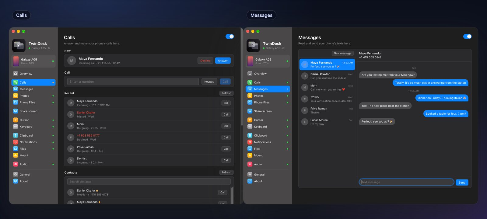
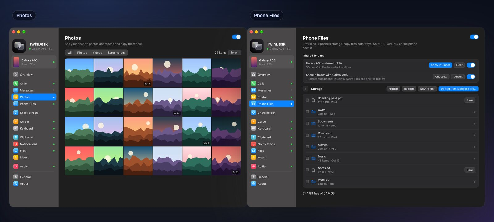
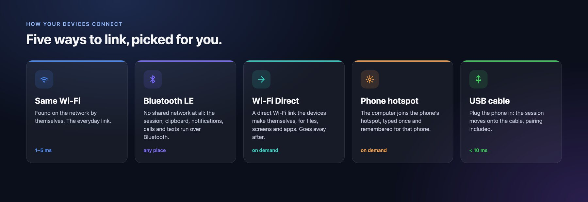

<p align="center">
  
</p>

<h1 align="center"><a href="https://twin-desk.vercel.app">TwinDesk</a></h1>

<p align="center">
  <b>All your computers and your phone, working as one desk.</b><br>
  Screens, apps, files, clipboard, cameras, calls, texts, notifications, mouse and keyboard, shared between Mac, Windows, Linux and Android.<br>
  Free and open source. No account, no cloud, no shared network needed.
</p>

<p align="center">
  <a href="#download"><b>⬇️ Download 2.3</b></a> ·
  <a href="https://twin-desk.vercel.app"><b>Website</b></a> ·
  <a href="#-new-in-23"><b>What's new</b></a> ·
  <a href="#-get-started"><b>Get started</b></a> ·
  <a href="#how-it-works"><b>How it works</b></a>
</p>

<p align="center">
  
  
  
  
  
  
  <a href="https://github.com/inukaasith/twindesk/releases"></a>
</p>

<p align="center">
  
</p>

Your devices are good at their own jobs and bad at working together. TwinDesk fixes that.
Put a **Mac and a Windows PC** side by side and use them with one mouse and keyboard. Open the
PC's apps on the Mac. Turn an old laptop or your **Android tablet** into a second screen. Answer
your **phone's calls and texts** from the computer, use its **camera in a video call**, and paste
on one device what you copied on another.

- **Any combination.** Mac ↔ Windows, Mac ↔ Mac, PC ↔ PC, Linux ↔ anything, and Android ↔ any computer. Or, with [TwinDesk Mesh](#-twindesk-mesh-every-device-at-once), all of them at once.
- **Anywhere.** Same Wi-Fi, a USB cable, or no shared network at all: Bluetooth and a direct Wi-Fi link of their own.
- **No account, no cloud.** Devices talk only to each other, on an encrypted link.
- **Only what you turn on.** Every feature starts off and isn't even loaded until you switch it on.

<table>
<tr>
<td width="33%" valign="top">

### 💻 [Computers](#-computer-to-computer)
One mouse and keyboard · second screen · the other computer's apps in windows · files · clipboard · **camera** · sound · terminal

</td>
<td width="33%" valign="top">

### 📱 [Phones and tablets](#-phone-and-tablet)
Calls · texts · photos · files · **camera** · **remote and gamepad** · screen and apps in windows · tablet as a second screen

</td>
<td width="33%" valign="top">

### 📡 [Connections](#-connections)
Same Wi-Fi · USB cable · **Bluetooth** · **Wi-Fi Direct** and **hotspot** links made on demand · picked for you, moved for you

</td>
</tr>
<tr>
<td width="33%" valign="top">

### 🚀 [Get started](#-get-started)
Download · open on both · pair once with a code · turn on what you want · [privacy](#privacy): no account, no telemetry

</td>
<td width="33%" valign="top">

### 🐧 [Linux](#linux) and 🤖 [Android](#android-in-detail) in detail
X11 and Wayland · shared folders through Samba · the phone app page by page · [wireless debugging](#wireless-debugging), set up once

</td>
<td width="33%" valign="top">

### 🛠 [Under the hood](#how-it-works)
[How it works](#how-it-works) · [build and run](#build-and-run) on macOS, Windows, Linux, NixOS and Android · [GitHub Actions](#github-actions)

</td>
</tr>
</table>

<a name="download"></a>

## ⬇️ Download

<table>
<tr>
<td width="25%" align="center" valign="top">

**🍎 macOS**<br><sub>13 Ventura or later</sub>

<a href="https://github.com/InukaAsith/TwinDesk/releases/download/v2.3.0/TwinDesk-2.3.0-arm64.dmg"></a><br>
<a href="https://github.com/InukaAsith/TwinDesk/releases/download/v2.3.0/TwinDesk-2.3.0-x64_Intel.dmg"></a><br>
<sub>Homebrew: <code>brew install --cask InukaAsith/twindesk/twindesk</code> (<a href="#macos-homebrew--terminal-install">more</a>)</sub>

</td>
<td width="25%" align="center" valign="top">

**🪟 Windows**<br><sub>10 and 11</sub>

<a href="https://github.com/InukaAsith/TwinDesk/releases/download/v2.3.0/TwinDesk-Setup-2.3.0.exe"></a><br>
<a href="https://github.com/InukaAsith/TwinDesk/releases/download/v2.3.0/TwinDesk-Setup-2.3.0-arm64.exe"></a>

</td>
<td width="25%" align="center" valign="top">

**🐧 Linux**<br><sub>X11 and Wayland, x86_64</sub>

<a href="https://github.com/InukaAsith/TwinDesk/releases/download/v2.3.0/TwinDesk-2.3.0-amd64.deb"></a><br>
<a href="https://github.com/InukaAsith/TwinDesk/releases/download/v2.3.0/TwinDesk-2.3.0-x86_64.AppImage"></a><br>
<a href="https://github.com/InukaAsith/TwinDesk/releases/download/v2.3.0/twindesk-bin-2.3.0-1-x86_64.pkg.tar.zst"></a><br>
<sub>NixOS: <code>nix run github:InukaAsith/TwinDesk</code> (<a href="#nixos--nix-flakes">more</a>)</sub>

</td>
<td width="25%" align="center" valign="top">

**🤖 Android**<br><sub>10 or later, phones and tablets</sub>

<a href="https://github.com/InukaAsith/TwinDesk/releases/download/v2.3.0/TwinDesk-2.3.0.apk"></a><br>
<sub>The full app (notifications, texts, Accessibility) is installed by the computer over wireless debugging</sub>

</td>
</tr>
</table>

<p align="center"><sub>Every file and older version is on the <a href="https://github.com/InukaAsith/TwinDesk/releases">releases page</a>.</sub></p>

---

# ✨ New in 2.3

<p align="center">
  
</p>

Your phone is now **a camera, a remote and a gamepad**. Use its camera in any video call, drive your
computer from the couch, or play with it as a controller. Copy pictures and screenshots across every
screen, and lock the pointer to one computer with a key.

| | What's new | |
|---|---|---|
| 📷 | **Camera.** The phone's camera, or the other computer's, in a window or as a webcam for Zoom, Teams and Meet | [More](#-phone-camera) |
| 🎮 | **Remote and gamepad.** A touchpad and keyboard for the computer, and a controller it sees as a real one | [More](#-remote-and-gamepad) |
| 🖼 | **Pictures on the clipboard.** Copy a screenshot on the PC, paste it on the Mac or the phone | [More](#-shared-clipboard) |
| 🔒 | **Cursor lock.** Scroll Lock keeps the pointer on the computer it's on | [More](#-one-mouse-and-keyboard) |
| 🎵 | **Media controls.** What's playing on the phone, with play, pause and skip on the computer | [More](#-media-controls-and-phone-sound) |
| 🪶 | **Lighter.** Every feature off until you turn it on, and about half the memory in the tray | [More](#-also-new-in-23) |

## ➕ Also new in 2.3

- **Every feature is off on a fresh install** and nothing of it is loaded until you switch it on. Updating keeps your settings.
- **Closed to the tray or menu bar, the window is gone too:** a Windows PC went from about 240 MB to about 125 MB.
- **<kbd>Ctrl+Alt+V</kbd> / <kbd>⌃⌥V</kbd> pastes files straight into the app in front**, a chat or an email, not only into a folder.
- **Choose where received files go** (General › Received files) on Windows and Linux, as on the Mac.
- **Phone windows:** Enter sends in WhatsApp, Instagram and Telegram; on Windows the controls sit in a side panel, with Rotate and a screenshot button.
- **The phone's own screen on the computer**, started from the phone's Screen page.
- **Touchpad mode** for the computer's screen on the phone: slide to move the pointer, tap to click.
- **The phone's battery:** a locked phone no longer lights up by itself, and discovery no longer keeps it awake.
- **Wireless debugging can switch itself off** when the computer is gone (General › Allow on the phone).
- **The pointer on the phone** shows over the notification shade and on Settings screens too.
- **Steadier Bluetooth and Wi-Fi Direct with phones**, and Android Studio or scrcpy's own adb is used before the bundled one, so they stop knocking each other off.
- **Intel Mac downloads** of their own, and builds that can be signed and notarized with a Developer ID.

Thanks to everyone who sent pull requests for this release: see [Thanks](#thanks).

<sub>Older releases: 2.2 brought [TwinDesk Mesh](#-twindesk-mesh-every-device-at-once), 2.1 brought
[Bluetooth and Wi-Fi Direct](#-connections) and the phone's [calls, texts, photos and files](#-calls-and-messages).
Every release's notes are on the [releases page](https://github.com/InukaAsith/TwinDesk/releases).</sub>

---

# 💻 Computer to computer

<p align="center">
  
</p>

The same app on every platform, so a Mac and a PC pair just like two Macs.

## 🖱 One mouse and keyboard

Push the pointer off the edge of your screen and **keep working on the other computer**, as if
they were one. Your keyboard follows the pointer. Trackpad gestures (Spaces swipes, pinch to zoom,
show desktop) carry over, and a double-tap of the hotkey brings everything home. Set which side the
other computer is on, edge resistance and pointer speed.

**Cursor lock** (new in 2.3) keeps the pointer on the computer it's on, even the one the mouse isn't
plugged into: press **Scroll Lock** (F14 on a Mac), or use the Cursor tab or the tray / menu bar.

## 🖥 Extended display and remote screen

Extend your Mac onto a PC or another Mac with a **real virtual display**, or mirror it. Or bring
the other computer's screen into a window and control it from there. Low-latency H.264 with
*Fastest* and *Smooth* playback, and optional frame generation.

<p align="center">
  
</p>

## 🪟 The other computer's apps, in windows of their own

Open a **Windows app on your Mac** (or a Mac app on your PC) and it gets **a window of its own**,
with its own Dock icon or Start-menu pin. No full remote desktop, just the app you need, next to
your own.

<p align="center">
  
</p>

## 📷 Camera sharing

Show the other computer's camera in a window, or send it to **a webcam every app can pick**:
**TwinDesk Camera** in Zoom, Teams, Meet or the browser. A computer shares its camera only when you
turn on *Let … see this camera* on it, and a popup there says who is watching. The same works with
a [phone's camera](#-phone-camera).

The virtual camera installs the first time you turn it on: a Windows 11 camera (one administrator
prompt), v4l2loopback on Linux (one password prompt), and on the Mac it goes into **OBS Virtual
Camera** (or TwinDesk's own camera extension, in builds signed for it).

## 📁 Files, shared folders and terminal

**Drag files across the screen edge** and drop them anywhere, or copy with <kbd>⌃⌥C</kbd> and
paste with <kbd>⌃⌥V</kbd> (<kbd>Ctrl+Alt+C/V</kbd> on Windows and Linux), into a folder or straight
into the app in front. Send from the macOS Share menu or Explorer's *Send to*, or **share a folder**
that shows up as a network drive on the other side. Files on their way show **live progress**.
Need a shell? `ssh twindesk` opens one on the other computer, no passwords needed.

<p align="center">
  
</p>

## 📋 Shared clipboard

Copy on one computer and paste on the other, instantly or when you switch over. **Pictures** go too
(new in 2.3), up to 10 MB: take a screenshot with <kbd>Win+Shift+S</kbd> on the PC and paste it on
the Mac. Entries from password managers are skipped, and a Recent list keeps the last few things
you copied, pictures with a preview.

<p align="center">
  
</p>

## 🔔 Notifications, sound and Wake-on-LAN

See one computer's notifications on the other as native notifications, and hear one computer's
sound on the other. Wake a sleeping computer with Wake-on-LAN, and every switch you flip is
shared by both sides and remembered for the pair.

## 🔀 More than two devices

Pair as many computers and phones as you like. **Switch** moves the session to another paired
device nearby, **Take over** claims one that's busy with someone else, and **Disconnect** lets go.
All from the Overview, the menu bar or the tray.

## 🕸 TwinDesk Mesh: every device at once

<p align="center">
  
</p>

Your laptop, your desktop, the Linux box in the corner and your phone, **all connected at once**,
each talking straight to the others with no hub in between.

- **One mouse, every screen.** Line your devices up on the map once, and the pointer goes from the PC to the Mac to the Linux laptop to the phone.
- **One clipboard.** Copy on any of them, paste on any other. The newest copy wins.
- **One notification pool.** Your phone buzzes, and every computer shows it.
- **Pair once, join all.** A new device paired with one computer meets the rest by itself.

Mesh is in **beta** on Windows, Mac and Linux: turn it on in the **Multi-device** tab, and off again
any time with everything as you left it. Connecting just two devices? You won't need it. Still
coming to Mesh: the Camera, pictures on the clipboard, and files dragged to more than one device at a
time; the phone connects to one computer at a time, and Linux joins over the same Wi-Fi only.

---

# 📱 Phone and tablet

Most phone links stop at notifications and a file drop. In TwinDesk your Android phone or tablet is
a **full peer**: it pairs like a computer and gets the same features, plus its calls, texts, photos,
files and camera.

## 📞 Calls and messages

Answer, decline and make your phone's calls from the computer. When it rings, a small window shows
who's calling with **Answer** and **Decline**. With Bluetooth, the computer becomes **the phone's
headset**, so you talk and listen right there. The **Calls** page has a number pad, your contacts
and the call history.

Read and reply to your texts on **Messages**: every conversation, pictures included, and a count in
the sidebar.

<p align="center">
  
</p>

## 🖼 Photos and phone files

Browse the phone's **photos and videos** on **Photos**, open any of them big, and save one or many
to the computer. **Phone Files** browses the phone's whole storage: save, upload, rename, delete, or
just drop files on the page. **Shared folders work both ways:** a folder the phone shares opens in
Finder, Explorer or the Linux file manager, and one the computer shares shows up in the phone's
Files app.

<p align="center">
  
</p>

## 📷 Phone camera

The phone's **back or front camera**, in a window on the computer or as the **TwinDesk Camera**
webcam in any video call. Switch cameras and rotate the picture from the Camera tab, or start it
from the phone's own Camera page.

## 🎮 Remote and gamepad

<p align="center">
  
</p>

The phone's **Remote** page turns it into the computer's remote, for the couch or a presentation:

- **Touchpad and keyboard.** Slide to move, tap to click, two fingers to scroll, with the keys a
  phone keyboard lacks (Esc, Tab, Ctrl, Alt, arrows, media and volume). Rotate it for landscape.
- **Gamepad,** laid out like an Xbox controller. Its buttons press the keys you choose, or turn on
  **Real gamepad** and the computer sees an actual controller: an Xbox 360 controller on Windows,
  a gamepad on Linux.
- **A Bluetooth gamepad for any computer**, the Mac included, with no TwinDesk and no driver there:
  pair the phone in the computer's Bluetooth settings once.

Turn on **Remote** on the computer to let the phone drive it.

## 🎵 Media controls and phone sound

What's playing on the phone shows in its card on the Overview, with its art, **Previous,
Play/Pause, Next** and a bar to seek. On Windows and Linux, **Play phone sound here** makes the
computer the phone's Bluetooth speaker.

## 📲 Phone screen and apps on the computer

See your phone's screen in a window and control it with your mouse, trackpad and keyboard. Better
still, open **single Android apps in windows of their own**, side by side with your desktop apps.
Pin them to the Dock or the Start menu and use them like any other app. In WhatsApp, Instagram and
Telegram, Enter sends.

<p align="center">
  
</p>

## 🖥 Tablet as a second screen

Turn a tablet or phone into an **extra monitor**. **Extend** for more desktop space, or **Mirror**
to show what's on your screen. Use touch as the mouse, or switch on touchpad mode.

<p align="center">
  
</p>

## 📤 Files, clipboard, notifications, mouse and keyboard

- **Files.** *Send to computer* or *Copy to computer* from any Android app's share menu; from the
  computer, the Share menu, *Send to*, a drag across the screen edge or <kbd>⌃⌥C</kbd> / <kbd>Ctrl+Alt+C</kbd>.
- **Clipboard.** Text and pictures both ways, the phone's screenshots included, and a Quick Settings tile to send it.
- **Notifications.** The phone's on the computer as native notifications, and the other way around. Hide the text or mute single apps.
- **Mouse and keyboard.** Push the pointer past the screen edge and it **carries on onto the phone**;
  type with your real keyboard in any Android app.

<p align="center">
  
</p>

## 📱 The Android app

The Android app adapts to the device: tabs at the bottom on a phone, a full sidebar on a tablet.
Every page names the computer you're connected to and shows what's shared in each direction.

<p align="center">
  
</p>

---

# 📡 Connections

<p align="center">
  
</p>

You never have to choose. TwinDesk uses the same network when there is one, moves a phone onto
the **USB cable** when you plug it in, and falls back to **Bluetooth** when the Wi-Fi goes: on a
train, or in a café whose guest Wi-Fi blocks devices. The link and its latency are always shown at
the top of the app (*38 ms · Bluetooth*).

Bluetooth is great for the session but too slow for a screen or a big file. So when you start one,
TwinDesk **brings up a direct Wi-Fi link** between the two devices for as long as it's needed, then
goes back to Bluetooth. Press **Connect with Wi-Fi Direct** to keep it, or let the computer join the
phone's **hotspot**.

| | Same Wi-Fi | USB cable | Bluetooth | + Wi-Fi Direct or hotspot |
|---|:-:|:-:|:-:|:-:|
| Session, clipboard text, notifications | ✅ | ✅ | ✅ | ✅ |
| Mouse and keyboard, remote | ✅ | ✅ | ✅ | ✅ |
| Calls and texts | ✅ | ✅ | ✅ | ✅ |
| Screens, apps, cameras, files, photos, clipboard pictures | ✅ | ✅ | moves to Wi-Fi Direct | ✅ |
| Terminal between computers (`ssh twindesk`) | ✅ | — | on Wi-Fi Direct | ✅ |

Who can turn up over Bluetooth is up to you: **Bluetooth with phones** (on) and **Bluetooth with
computers** (off until you want it), on the Overview and in General.

---

# 🚀 Get started

<p align="center">
  
</p>

1. **Download** TwinDesk for each computer and your phone ([above](#download), or from the [releases](https://github.com/InukaAsith/TwinDesk/releases/latest)).
2. **Open it on both.** They find each other on the same network, over Bluetooth, or over a USB cable for a phone.
3. **Pair once** by comparing a code (on a USB cable, just click Allow). From then on they connect by themselves.
4. **Turn on what you want.** Each feature has a tab with a switch, and shows what it does until you turn it on.

For the phone's screen, apps and camera in windows, TwinDesk walks you through turning on Android's
wireless debugging once ([details](#wireless-debugging)). Files, clipboard, calls and photos work
without it. The phone's notifications, texts, media controls and mouse and keyboard through
Accessibility come with the full app, which the computer installs once over wireless debugging.

| Pair | What you get |
|---|---|
| Mac ↔ Windows PC, Mac ↔ Mac, PC ↔ PC | Every computer feature |
| Linux ↔ Mac, PC or Linux | Every computer feature ([a few differences](#linux)) |
| Android ↔ Mac, Windows or Linux | Every phone and tablet feature (Real gamepad on Windows and Linux) |
| All of them at once | [TwinDesk Mesh](#-twindesk-mesh-every-device-at-once) (beta) |

## Privacy

TwinDesk only talks to devices you've paired with, directly over your own network, Bluetooth, a
direct Wi-Fi link or a cable. There are no accounts, no telemetry and no cloud relay. Your calls,
texts, photos and camera go straight from the phone to your computer and nowhere else. The only
internet request is an update check against GitHub's public releases, which you can turn off.

<br>

---


Everything below is for the curious and for people building TwinDesk themselves.

<a name="linux"></a>
<details>
<summary><h2>🐧 Linux</h2> <sub>X11 and Wayland, shared folders, Extend, virtual camera and gamepad</sub></summary>

On Linux, TwinDesk runs on both X11 and Wayland. On Wayland, the mouse and keyboard go through
evdev and uinput (the Setup screen grants access once), and screens are captured through the
desktop portal. A few things work a little differently:

- **Shared folder.** Sharing uses Samba. The first time, one password prompt installs it if it's
  missing and adds a network-only account. The other computer's folder is connected with GVFS
  and shows in the file manager's sidebar.
- **Copy and paste files.** <kbd>Ctrl+Alt+C</kbd> copies what's selected in the file manager in
  front (or files you already copied), and <kbd>Ctrl+Alt+V</kbd> pastes into the file manager
  window in front (else Downloads). Right-click › *Send to* works in Nautilus, Nemo, Caja,
  Dolphin and Thunar.
- **Dragging files across the edge.** Files dragged in from the other computer are dropped into
  the folder under the pointer, or the desktop. On Wayland, they go to the file manager window in
  front. Dragging files out of Linux needs an Xorg session.
- **Extend.** On GNOME (Wayland) it uses Mutter's own virtual monitor; pick "Virtual remote
  monitor" when the desktop asks which screen to share. On X11 it switches on a spare output of
  the graphics driver (not available on NVIDIA's driver). That needs a small helper, which the
  .deb installs; with the AppImage, Share screen › *TwinDesk virtual display* › Install puts it in
  once, with your password.
- **Apps.** Opening this computer's apps on the other side needs an Xorg session.
- **Virtual camera and gamepad.** TwinDesk Camera is a v4l2loopback device, and Real gamepad a
  uinput controller ("TwinDesk Gamepad"); each asks for your password once, the first time it's
  turned on.
- **Bluetooth and Wi-Fi Direct.** Bluetooth LE goes through BlueZ, and direct Wi-Fi links through
  NetworkManager, hosted beside the computer's own Wi-Fi where the adapter allows (2.4 GHz groups
  for a phone).
- **Android phone.** Everything in [Android](#android-in-detail) works on Linux too: the phone's screen and
  apps in windows, the mouse and keyboard across the edge, files, clipboard, notifications and
  sound. The package carries adb; the Setup screen's firewall fix opens mDNS (5353/udp) so the
  phone's wireless debugging is found.

</details>

<a name="android-in-detail"></a>
<details>
<summary><h2>🤖 Android in detail</h2> <sub>the phone app page by page, and wireless debugging</sub></summary>

Install TwinDesk on the phone, open it next to TwinDesk on the computer and pair from Overview › Nearby. The phone needs Android 10, and Android 11 for everything that goes through wireless debugging.

### The phone app

The app is laid out like the computers' (a sidebar on tablets, tabs at the bottom on phones), and
every page names the computer it's connected to:

| Page | What it does |
|---|---|
| **Overview** | The computer you're connected to, Connect and Disconnect, nearby computers to pair with, and the wireless debugging card until that's set up |
| **Screen** | Use the phone as a screen for the computer: Mirror, or Extend the desktop onto it. Touch works as the mouse (tap to click, hold to right click, drag to select or move windows, two fingers to scroll), with the computer's sound and Smooth playback |
| **Cursor** | The computer's mouse on the phone across the screen edge, its pointer speed here, reverse scrolling, right and middle click |
| **Keyboard** | The computer's keyboard types on the phone, every key as a key, so any layout works and the soft keyboard stays out of the way. A keyboard on the phone types on the computer |
| **Remote** | The phone as the computer's touchpad and keyboard, or as a gamepad: keys of your choosing, a real controller (Windows, Linux), or a Bluetooth gamepad for any computer |
| **Camera** | The phone's back or front camera on the computer, and whether its virtual camera takes it |
| **Clipboard** | Copy on one, paste on the other, each way on its own switch, at once or when sent |
| **Notifications** | The phone's notifications on the computer, with the text hidden if you like, and the computer's on the phone |
| **Files** | Send files, copy them to paste on the computer, and see where the computer's files land |
| **Sound** | The phone's sound on the computer, and the computer's sound on the phone |
| **General** | The phone's name, background running, and the permissions TwinDesk uses, each with its switch |
| **About** | Source code, releases, the license, and what goes over wireless debugging and the network |

And outside the app:

- **Share sheet:** *Send to computer* and *Copy to computer* in every app's Share menu.
- **Quick Settings tiles:** *Send clipboard* and *Wireless debugging*.
- **Home screen shortcuts:** the computer's screen, and wireless debugging on in one tap.
- **The ongoing notification** shows what's connected, with Exit.
- **Copied on the computer:** files copied with <kbd>⌃⌥C</kbd> / <kbd>Ctrl+Alt+C</kbd> arrive as a
  notification with Copy (paste them in any app) and Save.
- **The computer can install the full app** over wireless debugging (Phone page › Notifications
  from the phone): Play Protect blocks downloaded apps that read notifications or texts, or use
  Accessibility, so the download leaves those out and the computer adds them. Settings and pairing stay.

<a name="wireless-debugging"></a>

### Wireless debugging

Files, the clipboard and notifications work right away. The phone's screen, its apps in windows,
touch, your mouse and keyboard on the phone and its sound go through **wireless debugging**, which
TwinDesk pairs with once:

<p align="center">
  
</p>

- Until it's paired, a card under the connected computers on Overview (on the computer and on the
  phone) walks you through it. Open *Developer options › Wireless debugging › Pair device with
  pairing code* on the phone and type the 6-digit code on the computer, or on the phone in
  TwinDesk's notification (Settings' dialog stays open). The phone sends the code to whichever
  computer it's connected to: Mac, PC or Linux.
- After that TwinDesk switches wireless debugging on by itself when it needs it, follows it to its
  new port every time it restarts, and keeps the pairing from expiring (Android otherwise forgets
  a computer after 7 days unused). Phones that switch it off on every Wi-Fi change or screen lock
  (MIUI, HyperOS) get it switched back on as soon as they're unlocked, or a prompt if they refuse.
  Wireless debugging only runs while **USB debugging** is on too, so TwinDesk turns both on.
- **Xiaomi, Redmi and POCO** also need *Developer options › USB debugging (Security settings)* for
  touch, mouse and keyboard (it asks for a Mi account). Without it the screen shows but input is
  refused; the computer's Phone page says "Touch blocked" until it's on.
- **On a Mac, the phone in Finder.** Turn it on in the Mount tab and click Mount: the phone shows
  under Locations like any server. Until then TwinDesk never looks at the phone's files. It goes
  through the cable when USB debugging is allowed, else over wireless debugging. Finder's `.DS_Store` and `._` files never land on the phone.

</details>

<a name="how-it-works"></a>
<details>
<summary><h2>⚙️ How it works</h2> <sub>the Electron app, the native helpers and the link between devices</sub></summary>

<p align="center">
  
</p>

Each computer runs an **Electron app**, which handles the window, pairing, the link and the state
machines. Next to it runs a small **native helper** for everything the OS keeps to itself:
capturing and injecting input, virtual displays, gestures, window capture and native drag and drop.

| Folder | What's in it |
|---|---|
| `mac/` | macOS app (Electron) |
| `mac-helper/` | macOS helper (Swift): virtual display, event tap, input injection, audio, apps, SMB |
| `windows/` | Windows app (Electron) and installer |
| `windows-helper/` | Windows helper (C#): hooks, SendInput, Raw Input touchpad, window capture, native drag |
| `linux/` | Linux app (Electron) |
| `linux-helper/` | Linux helper (C): XInput2 / XTest on X11, evdev / uinput on Wayland, XRandR, window list, XDND edge strip |
| `android/` | Android app (Kotlin, Jetpack Compose); the computers drive the phone through adb and [scrcpy](https://github.com/Genymobile/scrcpy)'s server |
| `shared/` | Used by every app: the wire protocol, the Bluetooth pipe and Wi-Fi Direct links, the phone hub (Calls, Messages, Photos, Phone Files), shared folders, frame generation and icons |

The link between two devices is one TLS session wherever it runs: on the local network, through
a phone's USB cable (adb), or through **Bluetooth LE** (a GATT pipe of TwinDesk's own,
`shared/blepipe.js`). When a session on Bluetooth needs bandwidth, `shared/netlink.js` brings up a
**Wi-Fi Direct** group or joins a phone's hotspot, moves the session onto it, and takes it down
again once nothing needs it. Calls, Messages, Photos and Phone Files are `shared/phonehub.js` on
the computers, answered by TwinDesk on the phone.

Ports: TCP **47800** (control link) and UDP **47801** (discovery) on the local network.

</details>

<a name="build-and-run"></a>
<details>
<summary><h2>🛠 Build and run</h2> <sub>macOS, Windows, Linux, NixOS, Android and GitHub Actions</sub></summary>

You need [Node.js](https://nodejs.org) 18+ on every platform.

### macOS (13 Ventura or later)

```sh
xcode-select --install          # Swift compiler for the helper
cd mac
npm install
npm run build:helper
npm start                       # run from source
npm run dist && npm run dmg     # build TwinDesk.app and TwinDesk-<version>-<arch>.dmg in mac/dist/
```

The disk image is named after the app inside it: `TwinDesk-2.3.0-arm64.dmg` for Apple Silicon,
`TwinDesk-2.3.0-x64.dmg` for Intel. Keep those names on a release: the in-app updater picks the
one for each Mac by them.

By default, `npm run dist` targets the Mac's current architecture. To build an Intel
package from an Apple Silicon Mac, use:

```sh
npm run dist:x64 && npm run dmg
```

To build the Intel app and its image in one step, run `npm run dmg:intel`; it writes
`mac/dist/TwinDesk-<version>-x64.dmg`.

Use `npm run dist:arm64 && npm run dmg` for Apple Silicon explicitly. The x64 build
cross-compiles the Swift helpers and packages the x64 Electron runtime, so it does
not require an Intel Mac.

On first launch, TwinDesk asks for **Screen Recording**, **Accessibility** and **Input
Monitoring** (once; after that the General tab shows each permission's status).

`npm run dist` signs the app with a certificate of its own, made the first time in
`~/.twindesk-signing` (keep a backup). macOS keeps permissions per signature, so with the same
certificate they carry over when an update is dragged into Applications. An app built without it is
signed ad-hoc, and macOS treats every update as a new app; TwinDesk then clears the stale entries so
Allow works again.

<a name="macos-homebrew--terminal-install"></a>

### macOS Homebrew & Headless-Safe Installer

To install without Gatekeeper "Move to Bin" warnings, or to upgrade a headless Mac without losing remote mouse control:

```sh
# Option 1: Install via Homebrew
brew install --cask InukaAsith/twindesk/twindesk

# Option 2: 1-line Terminal installer (bypasses quarantine, hot-swaps running instance)
curl -fsSL https://raw.githubusercontent.com/InukaAsith/TwinDesk/main/mac/scripts/install.sh | bash
```

> **Headless & Mouse-less Upgrade**: If you control your Mac solely through TwinDesk without a physical mouse plugged into it, upgrading via Homebrew (`brew upgrade --cask twindesk`) or the installer script gracefully stops the running instance, updates `/Applications/TwinDesk.app`, clears quarantine, and relaunches it automatically in ~1 second so your remote cursor reconnects immediately.

### Windows 10 / 11

```bat
cd windows
npm install
npm run build:helper            :: uses the .NET Framework C# compiler that ships with Windows
npm start
npm run dist                    :: NSIS installer in windows\dist\
npm run dist -- arm64           :: the Windows on ARM installer (or `x64 arm64` for both)
```

`npm run dist` also works on a Mac or Linux: it skips the helper build and packages the
`macshare-winhelper.exe` already in `windows-helper\bin\` (for example, one taken from a release).

The installer adds the firewall rules (for every network profile, so a standard account on a
Public network doesn't need an administrator later). The Setup screen, shown once, offers to fix
the firewall if something changed (that needs an administrator) and to install the optional Virtual
Display Driver for Extend.

### Linux (X11 or Wayland)

```sh
sudo apt install build-essential libx11-dev libxi-dev libxtst-dev libxrandr-dev libxfixes-dev
cd linux
npm install
npm run build:helper
npm start
npm run dist                    # AppImage and .deb in linux/dist/
```

The Setup screen walks you through the rest. On Wayland that means input access (one admin
prompt, then log out and back in once). It can also install OpenSSH for the terminal. Extend on
GNOME Wayland uses Python 3 with GObject and GStreamer's PipeWire plugin (`python3-gi`,
`gstreamer1.0-pipewire`), which GNOME desktops already have.

<a name="nixos--nix-flakes"></a>

#### NixOS & Nix Flakes

TwinDesk includes a `flake.nix` with package, dev shell, and NixOS module support:

```sh
# Run directly with flakes
nix run github:InukaAsith/TwinDesk

# Or enter development environment
nix develop
```

On NixOS, enable the module in your system configuration:

```nix
{
  programs.twindesk = {
    enable = true;
    user = "yourusername"; # adds to input/uinput groups for Wayland KVM
  };
}
```

See [docs/nixos.md](docs/nixos.md) for full options (firewall, Wi-Fi Direct capability wrappers, virtual displays, and more).


#### Testing the Linux app from a Mac

`linux/scripts/vm-test.sh` runs it in a [Parallels Desktop](https://www.parallels.com) Linux VM
(Ubuntu with the packages above and Node.js): it copies this checkout into the VM, builds the
helper, starts TwinDesk in the VM's desktop session and drives it from the Mac.

```sh
linux/scripts/vm-test.sh start            # sync, build and (re)start it in the VM
linux/scripts/vm-test.sh shot linux.png   # screenshot of its window
linux/scripts/vm-test.sh eval "UI.go('cursor')"
linux/scripts/vm-test.sh log
```

On the VM's shared network it finds the Mac's TwinDesk and pairs like any Linux computer.

### Android

```sh
cd android
./gradlew assembleRelease        # JDK 17+; app/build/outputs/apk/{standard,full}/release/
```

`standard` is the build people download. `full` adds notification access, the SMS permissions
(Messages) and the Accessibility service (mouse and keyboard without wireless debugging), which Play Protect blocks in downloaded apps; the computers install it over wireless debugging (Phone page ›
Notifications from the phone), so `npm run dist` on each platform bundles the newest
`android/dist/*-full.apk`.

<a name="github-actions"></a>

### GitHub Actions

**Build Android**, **Build Linux** and **Build Windows** (Actions tab › Run workflow) make the
standard and full APKs, the AppImage and .deb, and the x64 and arm64 installers, helpers included.
Set the `ANDROID_KEYSTORE` secret to the key the Android app is signed with
(`base64 -i ~/.android/debug.keystore`): the APKs then install over existing ones, and the Linux and
Windows builds carry the full Android app. Without it the APKs get the runner's own key and the
computers' builds leave the Android app out.

To Authenticode-sign the Windows installers, set the `WIN_CSC_LINK` secret to a base64-encoded
Windows code-signing `.pfx` certificate and `WIN_CSC_KEY_PASSWORD` to its password. Keep the
certificate and password out of the repository. When `WIN_CSC_LINK` is set, the Windows build fails
if signing cannot complete instead of silently publishing an unsigned installer. Signing gives
users a verified publisher and can help SmartScreen reputation build over time; it does not
guarantee that antivirus products will stop flagging a file.

</details>

## Thanks

TwinDesk is better for everyone who sent a pull request:

- [@DevPsycho-07](https://github.com/DevPsycho-07): the phone as a remote ([#44](https://github.com/InukaAsith/TwinDesk/pull/44)), screenshots across the clipboard ([#45](https://github.com/InukaAsith/TwinDesk/pull/45)), phone window controls ([#46](https://github.com/InukaAsith/TwinDesk/pull/46)) and phone fixes ([#43](https://github.com/InukaAsith/TwinDesk/pull/43))
- [@benzntech](https://github.com/benzntech): the phone's camera ([#48](https://github.com/InukaAsith/TwinDesk/pull/48)), Developer ID signing and notarization ([#40](https://github.com/InukaAsith/TwinDesk/pull/40)) and the Mac's downloads ([#39](https://github.com/InukaAsith/TwinDesk/pull/39))
- [@atse25029-collab](https://github.com/atse25029-collab): WhatsApp and Instagram in phone windows ([#42](https://github.com/InukaAsith/TwinDesk/pull/42))
- [@philopaterwaheed](https://github.com/philopaterwaheed): Cursor lock ([#49](https://github.com/InukaAsith/TwinDesk/pull/49))
- [@ghustanov](https://github.com/ghustanov): wireless debugging's auto-off ([#31](https://github.com/InukaAsith/TwinDesk/pull/31)) and the Mac helpers' Info.plist ([#30](https://github.com/InukaAsith/TwinDesk/pull/30))
- [@m-uvex](https://github.com/m-uvex): the Nix flake and NixOS module ([#37](https://github.com/InukaAsith/TwinDesk/pull/37))
- Erdoğan Yeşil ([@erdodo](https://github.com/erdodo)): the mesh TwinDesk Mesh is built on ([#29](https://github.com/InukaAsith/TwinDesk/pull/29)), and [#8](https://github.com/InukaAsith/TwinDesk/pull/8) and [#9](https://github.com/InukaAsith/TwinDesk/pull/9)
- [@Jay-Prajapati01](https://github.com/Jay-Prajapati01): signed Windows installers ([#13](https://github.com/InukaAsith/TwinDesk/pull/13))

And thanks to everyone who reports problems and shares ideas in the [issues](https://github.com/InukaAsith/TwinDesk/issues).

## License

TwinDesk is free software, licensed under the [GNU General Public License v3.0](LICENSE).
Copyright © 2026 inukaasith.

Parts are adapted from [DeskPad](https://github.com/Stengo/DeskPad) (MIT). See [THIRD_PARTY_NOTICES](THIRD_PARTY_NOTICES)
for details.
